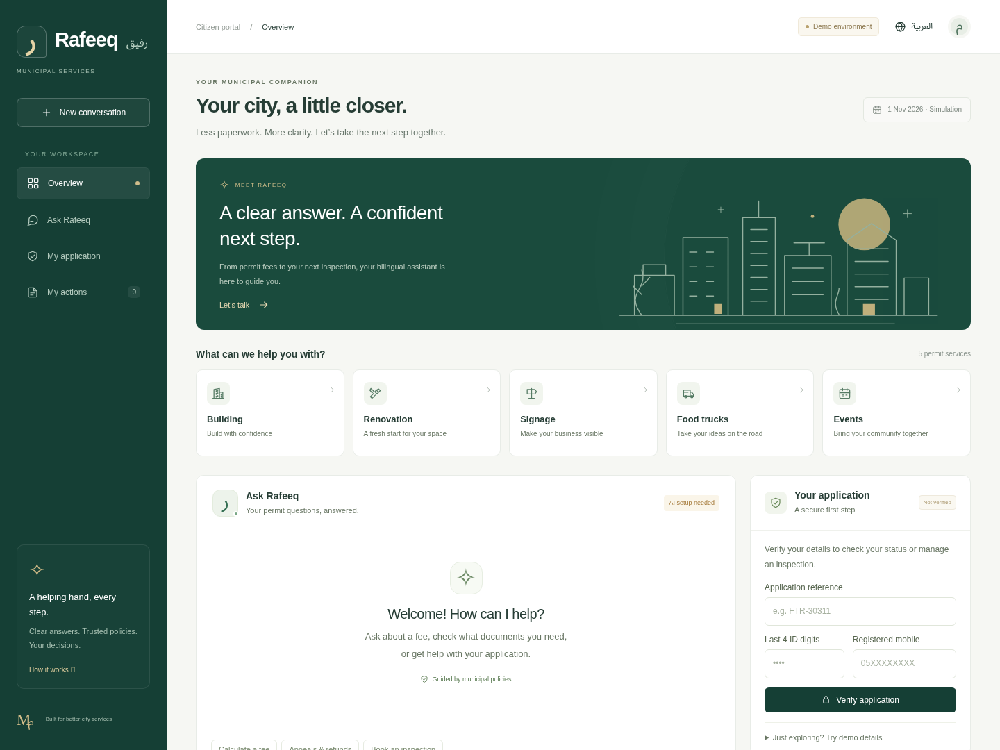

# Rafeeq · رفيق

A municipal permit assistant that speaks Arabic and English.

I built Rafeeq to help people work through a permit application in chat: understand the requirements,
calculate fees, submit an application, check its status, and arrange an inspection. It also explains
appeals and handles refund requests. It supports building (BLD), renovation (REN), signage (SGN),
food-truck (FTR), and event (EVT) permits.

The municipality and all records are fictional. Registration, payments, and refunds are simulated.



## How it works

Rafeeq looks up policies before answering questions and uses a calculator for fees. When it needs a
private application record, the citizen verifies their details through a form inside the chat.
Bookings, applications, and refunds appear as proposals for the citizen to review and confirm.
Licensing review and finance decisions have separate officer controls.

I kept the agent as a single Python tool-calling loop. FastAPI serves the chat and API, SQLite stores
sessions and actions, and a read-only MCP server provides policy search, fee calculation, and inspection
availability. The model runs through OpenRouter; there is no local model download.

- [Architecture and data flow](docs/architecture.md)
- [Security and privacy](docs/security.md)
- [Tests and results](docs/verification.md)

## Run locally

Use Python 3.12 and [uv](https://docs.astral.sh/uv/). Download or clone the **whole repository**:
Rafeeq also reads the data generator and policies under `labs/`.

### Windows / PowerShell

Open a terminal in `projects/rafeeq`, then run:

```powershell
py -m uv sync --frozen --python 3.12
if (-not (Test-Path .env)) { Copy-Item .env.example .env }
```

Edit `.env` and set `OPENROUTER_API_KEY` and `RAFEEQ_MODEL`. The completed live evaluation used
`google/gemini-2.5-flash`; the default free-model configuration is described below. It needs tool-calling support and available OpenRouter quota.
Keep the key in `.env`; the backend loads it automatically. Existing environment variables take precedence.

```powershell
py -m uv run uvicorn rafeeq.api:create_app --factory --host 127.0.0.1 --port 8000
```

Open http://127.0.0.1:8000. The API schema is at `/openapi.json`. Run one worker.
The interface and local tools work without a model key, but AI chat requires one.

### Linux / macOS

From the repository root:

```bash
cd projects/rafeeq
uv sync --frozen --python 3.12
if [ ! -f .env ]; then cp .env.example .env; fi
# Set OPENROUTER_API_KEY and RAFEEQ_MODEL in .env.
uv run uvicorn rafeeq.api:create_app --factory --host 127.0.0.1 --port 8000
```

The frontend uses local HTML, CSS, and JavaScript, with no Node build step. Add `?preview=1` to explore
the interface without a working provider connection. Chat and verification still need the backend.

### Fixed model and optional backup

`RAFEEQ_MODEL` selects a specific primary model. The default is
`nvidia/nemotron-3.5-lightning:free`; Rafeeq does not select random models by default.
The named backup is Google Gemma 4 31B, using the free tool-calling model ID documented in the
course repository. Current provider availability still needs a live check.

```dotenv
RAFEEQ_MODEL=nvidia/nemotron-3.5-lightning:free
RAFEEQ_FALLBACK_MODEL=google/gemma-4-31b-it:free
```

For an existing `.env`, update the backup line above and restart the server. An existing blank
`RAFEEQ_FALLBACK_MODEL=` disables switching; leaving that line out uses the default backup.
Automatic router IDs such as `openrouter/free` are not accepted as backups.

Chat can make one backup attempt if the primary has a connection/timeout failure, is unavailable,
returns a rate limit, or has a server error. A key, credit, or access error stops immediately.
There are at most two HTTP attempts per model step, covered by the cost reservation. Set the configured
pricing bounds high enough for either model. A free backup may share the same account quota, so switching
models cannot guarantee recovery from a daily limit.

The activity panel shows successful model selections and error codes. Connection failures and timeouts
have separate messages instead of asking for a new key. Live A/B evaluations disable the backup and
keep the same primary model on both configurations.

### Updating an existing copy

Keep your `.env` and `runtime/` directory. Reinstall dependencies with the frozen sync command after
updating. For ZIP downloads, extract into a new folder, copy those local files across, and open the new
folder in VS Code. Do not copy the old `.venv`.

If `rafeeq.evaluation_reporting` is missing, the download is incomplete. A complete copy includes that
module, `labs/prepare_data.py`, and `labs/data/policies/`. The evaluator's `--help` output should list
`--task-ids`, `--requests-per-minute`, and `--resume`.

## Try the demo

For the full chat workflow, ask **“I want to apply for a food truck permit.”** Rafeeq retrieves policy evidence
and opens a secure registration card inside chat. Use synthetic details only; identity fields are not sent to AI.
Registration opens an inline application form. Select the type and district, enter fee inputs, and declare the
documents you have. These are **demo declarations, not file uploads**. Review the fee and missing documents,
then confirm the proposal. A synthetic application and simulated payment are recorded atomically.

Complete declarations produce `submitted`; missing declarations produce `needs_info`. Submission does not
approve a permit. For a new application to become eligible for inspection, a separate licensing officer must
take it into review. Configure `RAFEEQ_REVIEWER_TOKEN` in your local `.env`, restart, then use **Licensing reviewer
demo workspace** at the bottom of the page. Validate declarations and start review. This token must be separate
from the finance token; the reviewer endpoint cannot approve/reject permits. Under-review FTR/EVT may have
pre-approval inspections, while approved BLD/FTR have the inspections allowed by POL-05.

Ask **“Book an inspection.”** Verification can happen inside a secure chat card. Rafeeq reads the recorded district,
uses a default simulation date range, and retrieves actual slots. If the model gives instructions without preparing a booking,
the backend offers a slot-selection card. Confirm the resulting proposal in chat to persist the booking.
Existing applicants can verify a reference to reconnect to their profile. No real account or money transfer is created.

Unrelated requests, including sorting code and weather, are rejected before model calls. Supported replies are
grounded by MCP policy retrieval. Markdown renders as safe DOM nodes; model HTML cannot execute. Lowercase
references, Unicode hyphens and Arabic numerals are normalized in the browser and backend.

1. Ask: “What is the fee for an illuminated 3 m² sign?” Expect a tool-computed 750 SAR and POL-02.
2. Verify synthetic applicant `FTR-30311`, last four ID digits `6654`, mobile `0532236654` using the form.
3. Ask: “Find inspection slots for FTR-30311 in Al-Rawdah on 4 November 2026 and propose 09:00.”
4. Confirm the action card. The booking is persisted only after this click. Repeated confirmation is idempotent.
5. Switch to Arabic and ask another policy question.
6. Demonstrate the finance gate with `SGN-40220`, `0093`, `0540410093`: rejected-fee refund is 2,700 SAR;
   citizen confirmation queues it for a separate officer decision. No real money moves.

**Time:** municipal records use a fixed **1 November 2026, 09:00 Asia/Riyadh** simulation clock,
explicitly labelled in the UI and prompt. The current actual date is supplied separately to the model.
Generated inspection availability ends after 15 working days. Do not book against the actual calendar.

## Design choices

I use policy retrieval rather than putting every policy into each prompt. Configuration A uses word
TF-IDF; B combines word and character n-grams with 55/45 weighting. The character index helps with
Arabic word variants. Both configurations use the same policies, model, permissions, and tools.

The backend enforces access and approval rules. A model cannot confirm its own proposal or act as a
licensing or finance officer. Private replies are left out of saved conversation history; later turns
must retrieve those records again through an authorized lookup. Public history is capped at 12 messages.

Each turn has an eight-step limit, up to four tool calls per model response, context and output limits,
and a 60-second deadline. The cost guard reserves an estimated upper bound for provider attempts.
It is not a billing cap, so provider-side spending limits still matter.

Verification lasts 15 minutes, proposals 10 minutes, and sessions 24 hours. The API limits a session to
15 requests per minute. Action decisions recheck ownership, eligibility, and availability inside a
SQLite transaction, and repeated confirmations return the stored result.

For the optional staff demo, set separate `RAFEEQ_REVIEWER_TOKEN` and `RAFEEQ_OFFICER_TOKEN` values in
`.env` and restart the server. These are local demo roles, not production staff authentication.

## Tools

| Tool | Transport | Effect | Approval |
|---|---|---|---|
| `search_policies` | MCP stdio | Read public policies | None |
| `compute_fee` | MCP stdio | Calculate public fee | None |
| `list_inspection_slots` | MCP stdio | Read public availability | None |
| `start_registration`, `start_verification`, `start_application` | In-process | Open secure inline forms | Citizen submits form |
| `my_applications` | In-process | Minimized owned references/status | Current identity verification |
| `submit_application` | In-process | Propose application + simulated payment | Citizen confirmation |
| `get_permit` | In-process | Minimized private read | Verified application scope |
| `book_inspection` | In-process | Propose booking | Citizen confirmation |
| `reschedule_inspection` | In-process | Propose reschedule | Citizen confirmation |
| `request_refund` | In-process | Propose refund | Citizen; also officer above 1,000 SAR |

Run the standalone read-only MCP server with `uv run python -m rafeeq.mcp_server`.
It speaks protocol messages on stdio; connect with an MCP client rather than typing into it.
Private records and writes are deliberately absent from this MCP server.

## API

All mutation endpoints require `X-Rafeeq-Client: 1`. Browser requests must be same-origin. Start a session first;
the server sets an opaque HttpOnly, SameSite=Strict cookie. HTTPS also enables Secure cookies.

| Method/path | Purpose |
|---|---|
| `GET /healthz` | Service status and whether an AI key is configured, never its value |
| `POST /api/session` | Start or resume a session |
| `DELETE /api/session` | Remove session memory/verification and cancel unconfirmed actions |
| `POST /api/verify` | `{permit_id, last4, mobile}`; never sent to AI provider |
| `POST /api/register` | Synthetic profile fields + explicit consent; never sent to AI provider |
| `GET /api/me` | Current citizen context, with application details hidden after verification expires |
| `GET /api/application-options` | Supported document declarations and districts |
| `POST /api/application-draft` | Prepare validated application proposal without submitting it |
| `POST /api/inspection-proposal` | Prepare a selected-slot proposal without booking it |
| `GET /api/reviewer/applications` | New application queue; separate reviewer token required |
| `POST /api/reviewer/begin-review` | Human reviewer starts review; no permit approval |
| `POST /api/chat` | `{message}` → reply, tools, action cards, stop reason, usage and trace ID |
| `GET /api/actions` | Current session's actions |
| `POST /api/actions/{id}/decision` | `{approve: true/false}` on immutable stored arguments |
| `GET /api/officer/actions` | Finance queue, requires `X-Officer-Token` |
| `POST /api/officer/actions/{id}/decision` | Separate officer decision |

The service is intended to run with **one worker**. Writes use SQLite transactions; approval decisions
revalidate eligibility and availability at execution time. Runtime records survive restarts. No auto-confirm route
is exposed to the model. Errors use JSON envelopes; tool errors do not reveal provider bodies or credentials.

## Tests and evaluation

From `projects/rafeeq` on Windows:

```powershell
py -m uv run pytest -q
py -m uv run ruff check .
py -m uv run python -m rafeeq.redteam
py -m uv run python -m rafeeq.evaluate retrieval
```

On Linux/macOS, use `uv run` in place of `py -m uv run`.

The latest Linux check passed **94 tests** and Ruff. The Windows run also passed **80 tests**
with Python 3.13.7, plus Ruff, the offline security check, and the same retrieval benchmark. Tests cover real MCP/database workflows,
registration, confirmations, privacy, budgets, and evaluation checkpoints. The offline security test
blocks unauthorized record access and an unavailable email tool. [Verification notes](docs/verification.md)
describe the browser checks and Windows coverage.

### Latest evaluation

I evaluated Rafeeq with `google/gemini-2.5-flash` on 29 October 2026 (Asia/Riyadh), using the same
26 tasks on both retrieval configurations and one trial per task.

I used Gemini through OpenRouter for the final evaluation after rate limits on the free-model routes
interrupted testing. I pinned the same Gemini model for both configurations and disabled the chat
backup during evaluation so model switching would not affect the comparison. Gemini and its provider
still have their own quotas; this choice does not remove rate limits.

| Configuration | Passed | Agent failures | Provider blocks | Unrun |
|---|---:|---:|---:|---:|
| A: word TF-IDF | 26/26 (100%) | 0 | 0 | 0 |
| B: word + character TF-IDF | 26/26 (100%) | 0 | 0 | 0 |

The [results and analysis](docs/results/gemini-2.5-flash-2026-10-29/README.md) include the original
summary and CSV, checked against all 52 transcript records. Three tasks per configuration are scope
refusals without model calls; the other 23 paired cases also passed. The tests exercise the whole
agent system, including backend checks, proposal fallbacks, and simulated human confirmations.
Both duplicate-refund cases used the eligible-proposal fallback; refunds still required confirmation,
and the high-value refund remained subject to finance approval.

The result is a tie on this task set. One trial does not establish repeated-run reliability or guarantee
success on unseen requests. Manual review found a reply-language mismatch, an off-target response to
an unauthorized reference, and imprecise email capability wording. The report records these separately
from the automated score.

### Retrieval benchmark

A separate benchmark uses 20 bilingual queries to check policy retrieval:

| Configuration | Top-1 | Top-3 |
|---|---:|---:|
| A: word TF-IDF | 15/20 | 18/20 |
| B: word + character TF-IDF | 18/20 | 19/20 |

B finds more of the expected policies in this small benchmark. Both still miss the Arabic building-document
query. These scores measure retrieval alone; they do not establish an advantage in full-agent task success.

### Run a live diagnostic

```powershell
$env:RAFEEQ_MODEL = "google/gemini-2.5-flash"
py -m uv run python -m rafeeq.evaluate live --task-ids fee-sign-en fee-foodtruck-ar status-verified-en status-verified-ar --requests-per-minute 10
```

This runs four tasks on both configurations. Once it works, run the full suite:

```powershell
py -m uv run python -m rafeeq.evaluate live --trials 1 --requests-per-minute 10
```

The full suite has 26 tasks per configuration. Each case gets a fresh synthetic database. Graders check
answers, citations, tool calls, privacy, action states, and database changes. Some cases include a
simulated human confirmation; the model itself never receives confirmation permission.

Results go into an ignored timestamped folder under `evals/results/`:

- `agent-results.csv`: task outcomes and usage.
- `summary.json`: totals, provider blocks, and coverage.
- `analysis.md`: aggregate failure categories and review notes.
- `transcripts.json`: replies and tool diagnostics for local inspection.
- `manifest.json` and `checkpoint.json`: experiment settings and progress.

The runner alternates A/B order, paces provider requests, and stops on a provider error. HTTP 429 can
mean minute quota, daily quota, or capacity; it does not establish that the key is invalid. Pacing
cannot restore an exhausted quota.

After provider access recovers, resume the diagnostic with its actual output folder:

```powershell
py -m uv run python -m rafeeq.evaluate live --task-ids fee-sign-en fee-foodtruck-ar status-verified-en status-verified-ar --requests-per-minute 10 --resume --output "evals/results/YOUR_RUN_FOLDER"
```

Resume keeps completed passes and agent failures, and retries blocked or unrun cases. Keep the same
source, model, tasks, trials, and request rate. After changing any of those, start a new experiment.
One trial is a first measurement; repeated trials are needed to assess consistency. Arabic fluency,
citation support, and misleading completion claims also need manual review.

## Known limits and next steps

Rafeeq is a local demonstration. It has no real identity provider, payment service, government integration,
or staff SSO. The last-four-digits/mobile check is a simulation. Appeals are guidance and drafting only.
Withdrawn-application refunds go to a finance officer because the sample records do not prove the
withdrawal stage. Later-stage repeat inspections also need officer handling.

The final live suite and user-message privacy/approval attacks passed on both configurations.
Further work includes repeated trials, language-matching checks, better different-reference replies,
clearer capability wording, a full accessibility audit, and a retrieved-document injection experiment. Real deployment
would need stronger identity, account/IP rate limits, retention controls, and operational monitoring.

## Course background and credits

I built Rafeeq as my accomplishment project for the **Advanced Agentic AI Systems Engineering** course at SDAIA Academy,
following the “Rafeeq in production” track.
- [Course repository](https://github.com/SDAIAAcademy/agentic-ai)

The course requirements cover a multi-step agent with at least three tools including MCP, context and
memory/retrieval with a budget rule, human approval for a write action, step/cost budgets, 15+ evaluation
tasks on two configurations with error analysis, and a security note with an attack and defence.
The assessment weights are working system 25%, context/harness 25%, evaluation 20%, security/governance/
operability 20%, and presentation/reproducibility 10%.

This project builds on the course's Madar data generator, bilingual policies, starter concepts, and API
examples. The original course materials remain in the repository. See the upstream repository for
those materials and reuse terms.
