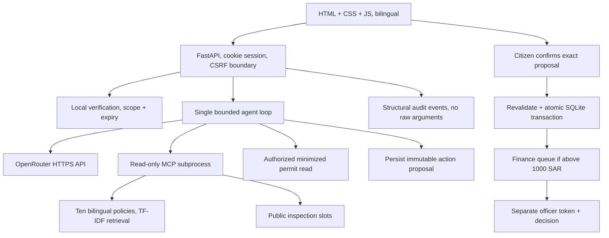
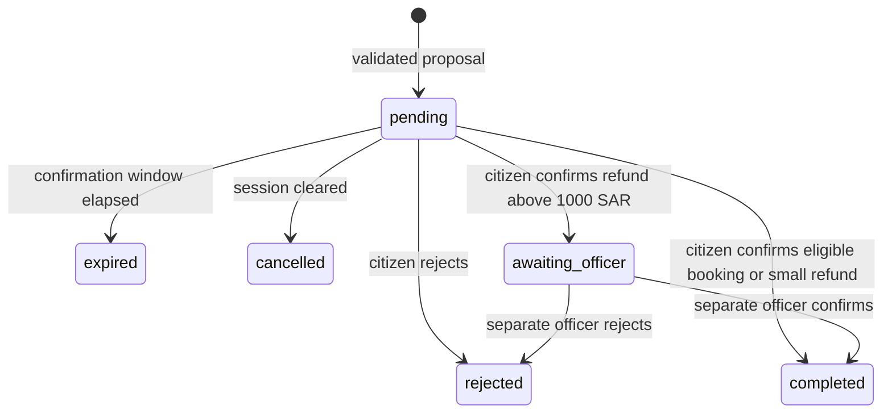

# Architecture

I kept Rafeeq as one agent loop with a separate read-only MCP server. Python handles access checks
and confirmations; the model chooses tools and writes replies. SQLite holds the state between turns.

Source modules separate settings, strict schemas, storage, business rules, retrieval, MCP, agent and API.
The MCP subprocess has its own SQLite connection, reads shared slots, and never initializes over an existing DB.
Model API and officer credentials are removed from its environment, and dotenv loading is disabled there.

## SQLite state

- `sessions`: opaque random ID, bounded public history, expiration, verified permit scope and expiry,
  failed-verification count, rate window/count and authenticated synthetic citizen reference. Existing databases
  are migrated additively to add this reference without resetting records.
- `actions`: random action ID, owner session, tool, canonical validated arguments, status, expiration, result.
- `events`: timestamp, trace ID, event name, structural metadata. No raw messages, tool arguments or outputs.
- Course tables: synthetic applicants, permits, payments, inspections and slots; refunds are simulated records.

No monetary or inspection side effect occurs at proposal time. A transaction locks and rechecks state on decision,
so duplicate decisions return the stored terminal result. Officer decisions use immutable stored arguments;
the browser cannot replace slot or refund amount. Finance expiry is checked at decision time.

## Data flow and minimization

Verification form → backend comparison against synthetic records → application-scoped session flag.
Inline registration card → local profile endpoint → inline application form → immutable submission proposal →
citizen confirmation → synthetic application/payment records. Licensing review is a separate authorized endpoint,
not an agent tool; submission never implies permit approval. Inspection proposals still require eligible status.
The model never receives the form's mobile or ID digits. Model-driven lookup → scope check → selected fields only.
Public chat → bounded SQLite history; private task replies → generic context placeholder rather than saved facts.
The browser renders a small Markdown subset into safe DOM nodes; arbitrary model HTML remains inert text.

Runtime data stays in `runtime/` across restarts. The server runs as a single worker; background
processes need to be started again when moving to a new machine.

## Model availability

The primary model is fixed by `RAFEEQ_MODEL`. `RAFEEQ_FALLBACK_MODEL` defaults to
`google/gemma-4-31b-it:free`, the course's documented free tool-calling model. A blank value disables the
backup; no automatic router is accepted for that setting. Chat makes at most two HTTP attempts per
model step. The backup is eligible on transport failures, 404/429, and 500/502/503/504 responses.
Authentication, credit, and access errors stop without switching. Without a backup, only the existing
502/503 retry remains. Requests require tool-compatible providers.

Successful selected model IDs are included in turn usage and activity details. Safe connection,
timeout, invalid-response, and HTTP error classifications are returned without raw provider bodies.
A/B evaluation clears the backup setting so an availability fallback cannot change the experimental model.
The cost estimate still reserves two attempts using the configured upper-bound prices for both models.
